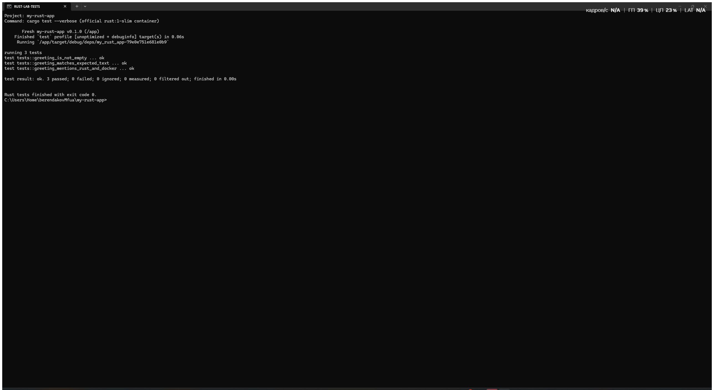
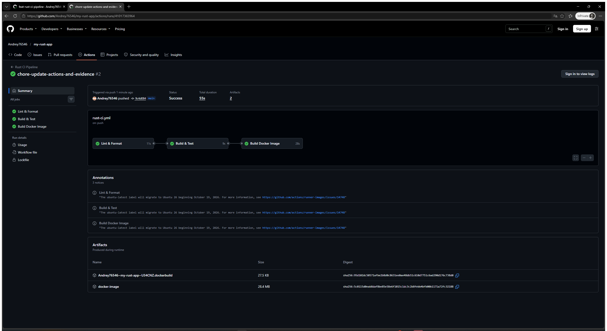
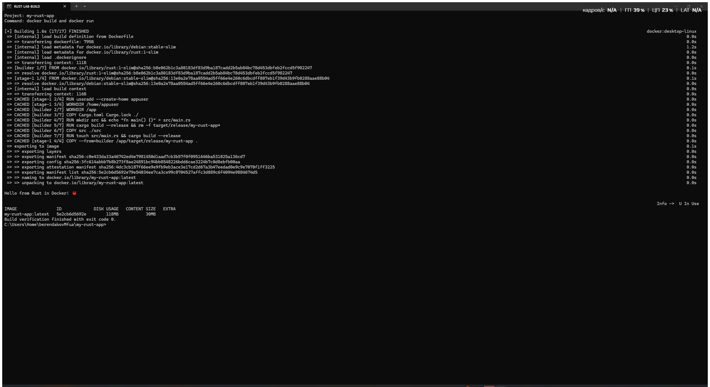

# Лабораторная работа: Pipeline CI на Rust

## Цель работы

Настроить непрерывную интеграцию Rust-приложения: автоматические проверки форматирования и Clippy, debug/release-сборки, модульные тесты, сборку и запуск Docker-образа, а также сохранение образа как артефакта GitHub Actions.

Задание выполнено по [инструкции преподавателя](https://github.com/rurewa/imfua/blob/main/content/DevOps/CI_CD/Pipelines/Rust_CI_1.md).

## Использованные технологии

- Rust stable, Cargo, rustfmt и Clippy;
- Docker и многоэтапный Dockerfile;
- GitHub Actions;
- `actions/upload-artifact` для сохранения Docker-образа.

## Описание выполненных действий

1. Создан Cargo-проект `my-rust-app`.
2. Реализована функция `greeting()` и консольное приложение с требуемым выводом.
3. Добавлены три модульных теста: точное значение, ключевые слова и непустая строка.
4. Настроены rustfmt и Clippy с запретом предупреждений.
5. Настроены `cargo check`, debug/release-сборки и `cargo test`.
6. Создан многоэтапный Dockerfile с непривилегированным пользователем.
7. Docker-образ запускается в CI и сохраняется как артефакт на 7 дней.
8. Локально выполнены форматирование, линтинг, тестирование, release-сборка, сборка и запуск контейнера.

В шаблоне Dockerfile преподавателя исправлено кэширование фиктивного `main.rs`: команда `touch src/main.rs` гарантирует сборку настоящего исходного файла.

## Структура проекта

```text
my-rust-app/
├── .github/workflows/rust-ci.yml
├── screenshots/
│   ├── 01-tests.png
│   ├── 02-github-actions.png
│   └── 03-build.png
├── src/main.rs
├── .dockerignore
├── .gitignore
├── Cargo.lock
├── Cargo.toml
├── Dockerfile
└── README.md
```

## Команды запуска

```bash
cargo run
cargo build --release
docker build -t my-rust-app:latest .
docker run --rm my-rust-app:latest
```

Ожидаемый вывод приложения:

```text
Hello from Rust in Docker! 🦀
```

## Тестирование и проверка

```bash
cargo fmt --all -- --check
cargo clippy --all-targets --all-features -- -D warnings
cargo check --verbose
cargo build --verbose
cargo build --release --verbose
cargo test --verbose
```

Локальный результат: `3 passed; 0 failed`. Docker-образ успешно собран и запущен.

## Настройка GitHub Actions

Workflow [Rust CI Pipeline](https://github.com/Andrey76546/my-rust-app/actions/workflows/rust-ci.yml) запускается при push и pull request в `main`/`master`, а также вручную. Он содержит три последовательных job:

- `Lint & Format` — rustfmt и Clippy;
- `Build & Test` — `cargo check`, debug/release-сборки и тесты;
- `Build Docker Image` — Buildx, сборка и запуск контейнера, загрузка `docker-image.tar.gz`.

Успешный запуск: [Rust CI Pipeline #2](https://github.com/Andrey76546/my-rust-app/actions/runs/41017365964). Все запуски: [GitHub Actions](https://github.com/Andrey76546/my-rust-app/actions).

## Результаты выполнения

- форматирование соответствует rustfmt;
- Clippy завершается без предупреждений;
- все 3 модульных теста проходят;
- release-бинарник и Docker-образ успешно собираются;
- контейнер выводит требуемое приветствие;
- GitHub Actions выполняет все три job.

## Настоящие скриншоты



Снимок подтверждает реальный запуск `cargo test --verbose`: 3 теста пройдены, ошибок нет.



Снимок подтверждает успешное выполнение workflow `Rust CI Pipeline` с зелёными статусами.



Снимок подтверждает успешную Docker-сборку, запуск контейнера и наличие образа `my-rust-app:latest`.

## Вывод

Создан воспроизводимый CI-конвейер Rust-проекта. Код автоматически форматируется и анализируется, собирается в двух профилях, покрыт модульными тестами и упаковывается в проверенный Docker-образ с артефактом для локального использования.

